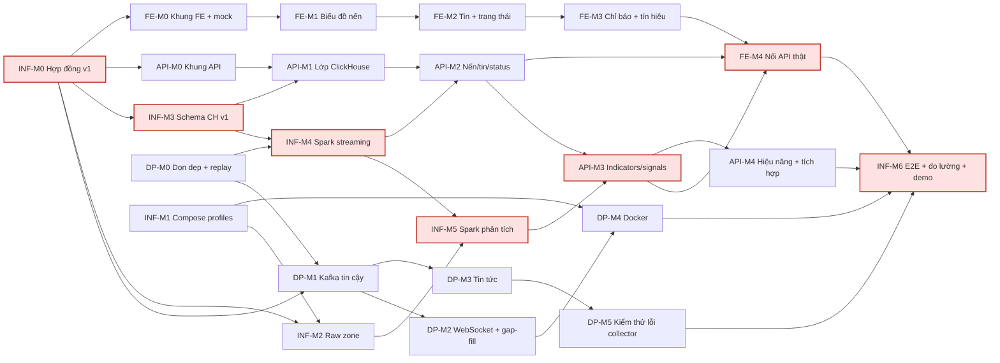

# Crypto Intelligence System — Tổng quan dự án, hợp đồng chung và lịch tích hợp

> Ngày lập: 2026-10-27. Dựa trên rà soát code tại `data-pipeline@a7a0df4`, `infrastructure@47ba79a`, `backend-api@de43ca9`, `frontend-dashboard@30f4a4e`.
> Chi tiết vấn đề và lộ trình từng repo nằm trong 4 file ROADMAP (mục 6). Trích dẫn `file:dòng` theo nhánh `main` tại các commit trên.

## 1. Tóm tắt điều hành

- Quy ước lịch: **Tuần 1 = 19–25/10/2026** (ngày tạo repo). Hôm nay thuộc **tuần 2**; còn 7 tuần tới demo (tuần 8: 07–13/12).
- Code đã phủ phần lớn tuần 1–4 (collector, Kafka KRaft, raw-sink MinIO, schema ClickHouse) và bản nháp Spark batch, nhưng **chưa từng chạy end-to-end**.
- `backend-api` và `frontend-dashboard` **còn trống**.
- 4 lỗ hổng chặn demo: collector mất bản ghi khi Kafka lỗi; **không có ai ghi vào ClickHouse `market_data`/`news_data`**; **không có Spark Structured Streaming**; **không có hợp đồng dữ liệu chung**.
- Việc đầu tiên (tuần 2): chốt **hợp đồng v1** tại `infrastructure/contracts/v1/` (mục 3). Mọi repo tham chiếu tới đó, không tự định nghĩa lại.
- Sau hợp đồng, 4 người làm song song nhờ mock: replay file mẫu vào Kafka (B), fixture ClickHouse (C), Prism mock từ OpenAPI (D).
- Đường găng: hợp đồng → schema ClickHouse v1 → Spark streaming → Spark phân tích → API phân tích → Dashboard tích hợp → E2E (mục 5.3).
- Mốc kiểm chứng đầu tiên: **cuối tuần 3** chạy thông collector → Kafka → MinIO; **cuối tuần 5** chạy thông tới API `/candles`.

## 2. Bảng hiện trạng tính năng × repo

Ký hiệu: ✅ Xong · 🟡 Dở · ⬜ Chưa có · 🔴 Có vấn đề

| Tuần KH | Tính năng | data-pipeline | infrastructure | backend-api | frontend-dashboard |
|---|---|---|---|---|---|
| 1 | Phạm vi BTCUSDT/ETHUSDT 1m | ✅ `.env.example:2-3` | — | — | — |
| 1 | Sơ đồ kiến trúc | ⬜ | ⬜ | ⬜ | ⬜ |
| 1 | Hợp đồng JSON chung | 🔴 chỉ dataclass `collector/models.py:17-56` | ⬜ | ⬜ | ⬜ |
| 2 | Nến lịch sử REST + phân trang | ✅ nhưng Futures `collectors.py:129` | — | — | — |
| 2 | WebSocket kline 1m (`k.x == true`) | ⬜ polling 60 s `main.py:107-115` | — | — | — |
| 2 | Chỉ nến đã đóng | ✅ `collectors.py:102-119` | — | — | — |
| 2 | Lấp khoảng trống sau mất kết nối | 🟡 ngầm qua `limit=100` | — | — | — |
| 2 | Tin tức CoinDesk | 🟡 chỉ RSS, không dự phòng | — | — | — |
| 2 | Validate + dedupe | ✅ `validation.py`, `output.py:12-31` | — | — | — |
| 3 | Kafka KRaft + topic | — | ✅ `docker-compose.yml:2-41` | — | — |
| 3 | Producer → Kafka | 🔴 mất dữ liệu khi lỗi `main.py:46-55` | — | — | — |
| 3 | Collector chạy trong Docker | ⬜ | ⬜ | — | — |
| 4 | Raw zone MinIO theo ngày | — | 🟡 `raw-sink/consumer.py` (1 object/bản ghi, key có `:`) | — | — |
| 4 | Metadata ingest | 🟡 có trong payload | 🟡 thiếu offset/`ingested_at` | — | — |
| 5 | Bảng ClickHouse | — | 🟡 `clickhouse/init/001_schema.sql` | — | — |
| 5 | Nạp nến vào ClickHouse | — | ⬜ không có writer | — | — |
| 5 | Gộp 5m / MA20 | — | 🔴 ghi trùng, nhãn sai `batch_market_analysis.py:58,117-127` | — | — |
| 6 | Spark Structured Streaming | — | ⬜ | — | — |
| 6 | Spark batch đọc `s3a://` | — | 🟡 chưa chạy thử | — | — |
| 7 | API | — | — | ⬜ repo trống | — |
| 7 | Dashboard | — | — | — | ⬜ repo trống |
| 8 | E2E, kiểm thử lỗi, đo độ trễ | ⬜ | ⬜ | ⬜ | ⬜ |
| — | Unit test | ✅ 22 test pass | ⬜ | ⬜ | ⬜ |
| — | CI | ⬜ | ⬜ | ⬜ | ⬜ |

Issue/PR mở: `data-pipeline#2` (chưa làm Spark — thuộc INF-M4/M5), `data-pipeline#3` (đã bị `a7a0df4` thay thế, xung đột, đề xuất đóng), `infrastructure#2` (báo cáo rà soát lần 1).

## 3. Hợp đồng chung v1 (đề xuất)

### 3.1 Vị trí và quy tắc phiên bản

```
infrastructure/contracts/
  README.md                         # mục lục, quy tắc đổi phiên bản, changelog
  v1/
    market_kline.schema.json        # JSON Schema draft 2020-12 cho message market_data
    news_article.schema.json        # cho message news_data
    raw_envelope.schema.json        # dòng NDJSON trong MinIO
    openapi.yaml                    # API response (backend-api triển khai, frontend sinh type)
    env-and-ports.md                # biến môi trường + port dùng chung
    examples/                       # 1 file hợp lệ + 1 file lỗi cho mỗi schema
```

- Nguồn sự thật duy nhất là `infrastructure/contracts/v1/`. Schema ClickHouse là `infrastructure/clickhouse/init/*.sql` (đã ở infrastructure) và `contracts/README.md` trỏ tới.
- Repo khác **vendor** bản sao qua script `scripts/sync_contracts.py` (đọc từ `../infrastructure/contracts/v1`) để CI chạy độc lập mà không cần token truy cập repo private khác. CI của mỗi repo kiểm tra bản sao khớp `contracts/v1/VERSION`.
- Thay đổi tương thích ngược (thêm trường optional) → giữ `schema_version: "1.x"`, tăng minor. Thay đổi phá vỡ → thư mục `v2/`, chạy song song tới khi mọi consumer chuyển.
- Mọi PR sửa `contracts/` cần review của **cả 4 vai trò**.

### 3.2 Kafka

| Topic | Key | Value | Partition | Retention | Producer | Consumer |
|---|---|---|---|---|---|---|
| `market_data` | `symbol` (UTF-8, vd `BTCUSDT`) | `market_kline` v1 | 3 | 7 ngày | data-pipeline | raw-sink, Spark streaming |
| `news_data` | `article_id` | `news_article` v1 | 3 | 7 ngày | data-pipeline | raw-sink, Spark streaming |
| `market_data_dlq`, `news_data_dlq` | giữ nguyên key gốc | message gốc + header `error` | 1 | 7 ngày | raw-sink, Spark | người vận hành |

Producer: `acks=all`, `enable_idempotence=True`, `compression_type=gzip`. Consumer group: `raw-sink-minio`, `spark-stream-market`, `spark-stream-news`.

### 3.3 Message `market_kline` v1

Giữ tên trường như `collector/models.py:17-33` hiện tại để giảm thay đổi; bổ sung ràng buộc.

| Trường | Kiểu JSON | Bắt buộc | Ràng buộc / ghi chú |
|---|---|---|---|
| `schema_version` | string | ✔ | `"1.0"` |
| `data_type` | string | ✔ | const `"market"` |
| `source` | string | ✔ | enum `binance_spot` \| `binance_futures` (chốt ở Q1) |
| `symbol` | string | ✔ | `^[A-Z0-9]{5,20}$` |
| `interval` | string | ✔ | `"1m"` (v1) |
| `open_time` | string | ✔ | ISO-8601 UTC, mili giây, hậu tố `Z`: `2026-10-27T08:00:00.000Z` |
| `close_time` | string | ✔ | như trên; = `open_time + 59.999 s` |
| `open`, `high`, `low`, `close` | number | ✔ | > 0, hữu hạn, `low ≤ open,close ≤ high` |
| `volume`, `quote_volume` | number | ✔ | ≥ 0 |
| `trade_count` | integer | ✔ | ≥ 0 |
| `collected_at` | string | ✔ | thời điểm collector nhận dữ liệu, ISO-8601 UTC ms `Z` |

Khóa duy nhất: `(source, symbol, interval, open_time)`. Chỉ phát nến đã đóng.

### 3.4 Message `news_article` v1

| Trường | Kiểu | Bắt buộc | Ghi chú |
|---|---|---|---|
| `schema_version` | string | ✔ | `"1.0"` |
| `data_type` | string | ✔ | const `"news"` |
| `source` | string | ✔ | enum `coindesk` \| `coindesk_rss` \| `cointelegraph_rss` (chốt ở Q3) |
| `article_id` | string | ✔ | `sha256(url)[:24]` |
| `title`, `url` | string | ✔ | không rỗng |
| `summary` | string | ✔ | có thể rỗng, đã bỏ HTML |
| `published_at`, `collected_at` | string | ✔ | ISO-8601 UTC ms `Z` |
| `symbols` | array<string> | ✔ | có thể rỗng |
| `sentiment` | string \| null | ✔ | `null` ở v1 |

Khóa duy nhất: `(source, article_id)`.

### 3.5 Đường dẫn MinIO

| Dữ liệu | Đường dẫn | Ghi bởi |
|---|---|---|
| Raw market | `s3a://raw-data/market/yyyy/mm/dd/part-<partition>-<firstOffset>.jsonl` | raw-sink |
| Raw news | `s3a://raw-data/news/yyyy/mm/dd/part-<partition>-<firstOffset>.jsonl` | raw-sink |
| Checkpoint streaming | `s3a://checkpoints/<job-name>/` | Spark |
| Kết quả batch (tùy chọn) | `s3a://curated/<dataset>/date=yyyy-mm-dd/*.parquet` | Spark batch |

- Ngày phân vùng theo `open_time` (market) / `published_at` (news), UTC.
- Tên object **không chứa `:`** (tránh lỗi Hadoop `Path`, xem INF H3).
- Mỗi dòng là một `raw_envelope`:

```json
{"ingested_at":"2026-10-27T08:01:00.120Z","kafka":{"topic":"market_data","partition":1,"offset":1234,"key":"BTCUSDT"},"payload":{ "...message market_kline v1..." : "" }}
```

### 3.6 ClickHouse (database `pipeline`)

| Bảng | Engine | ORDER BY | PARTITION BY | Ghi bởi | Đọc bởi |
|---|---|---|---|---|---|
| `market_data` | `ReplacingMergeTree(collected_at)` | `(symbol, interval, open_time)` | `toYYYYMM(open_time)` | Spark `stream_market` | API `/candles` |
| `news_data` | `ReplacingMergeTree(collected_at)` | `(source, article_id)` | `toYYYYMM(published_at)` | Spark `stream_news` | API `/news` |
| `candles_5m` | `ReplacingMergeTree(computed_at)` | `(symbol, open_time)` | `toYYYYMM(open_time)` | Spark batch | API `/candles?interval=5m` |
| `indicators` | `ReplacingMergeTree(computed_at)` | `(symbol, interval, name, event_time)` | `toYYYYMM(event_time)` | Spark batch | API `/indicators` |
| `signals` | `ReplacingMergeTree(computed_at)` | `(symbol, signal_type, event_time)` | `toYYYYMM(event_time)` | Spark streaming | API `/signals` |

- `market_data` và `news_data` giữ cột như `001_schema.sql:3-41`, thêm `ingested_at DateTime64(3,'UTC') DEFAULT now64(3)` để đo độ trễ.
- `candles_5m`: `symbol, open_time, close_time, open, high, low, close, volume, quote_volume, trade_count, candle_count UInt8, computed_at`.
- `indicators`: `symbol, interval, name ('ma20'), event_time, value Float64, computed_at`.
- `signals`: `symbol, signal_type ('volume_anomaly'), event_time, value Float64, threshold Float64, details String (JSON), computed_at`.
- `analysis_results` (`001_schema.sql:43-55`) **ngừng dùng** sau khi `indicators` chạy; xóa ở v2.
- Truy vấn đọc luôn dùng `FINAL` (hoặc `argMax`) để loại bản trùng chưa merge.

### 3.7 API (chi tiết trong `contracts/v1/openapi.yaml`)

Base URL: `http://localhost:8000/api/v1`. Mọi thời gian trả về ISO-8601 UTC ms `Z`.

| Method + path | Tham số | `data` |
|---|---|---|
| `GET /health` | — | `{status, clickhouse: "ok"\|"down"}` |
| `GET /symbols` | — | `["BTCUSDT","ETHUSDT"]` |
| `GET /candles` | `symbol`*, `interval=1m\|5m`, `from`, `to`, `limit≤1000` (mặc định 500) | `[{open_time, open, high, low, close, volume, quote_volume, trade_count}]` tăng dần theo `open_time` |
| `GET /indicators` | `symbol`*, `name=ma20`, `interval=5m`, `from`, `to`, `limit` | `[{event_time, value}]` |
| `GET /signals` | `symbol`, `type=volume_anomaly`, `from`, `to`, `limit≤200` | `[{symbol, signal_type, event_time, value, threshold, details}]` giảm dần |
| `GET /news` | `symbol`, `from`, `to`, `limit≤100` (mặc định 20) | `[{article_id, source, title, summary, url, published_at, symbols}]` giảm dần |
| `GET /status` | — | `{symbols:[{symbol, last_open_time, lag_seconds}], last_news_at, generated_at}` |

Envelope thành công:
```json
{"data": [ ... ], "meta": {"count": 500, "symbol": "BTCUSDT", "interval": "1m", "generated_at": "2026-10-27T08:01:02.000Z"}}
```
Envelope lỗi (HTTP 400/404/422/503):
```json
{"error": {"code": "INVALID_PARAMETER", "message": "interval must be one of 1m, 5m"}}
```

### 3.8 Biến môi trường và port dùng chung

| Biến | Giá trị trong Docker | Giá trị từ máy host | Dùng bởi |
|---|---|---|---|
| `KAFKA_BOOTSTRAP_SERVERS` | `kafka:29092` | `localhost:9092` | DP, raw-sink, Spark |
| `KAFKA_MARKET_TOPIC` / `KAFKA_NEWS_TOPIC` | `market_data` / `news_data` | như trên | DP, raw-sink, Spark |
| `MINIO_ENDPOINT` | `http://minio:9000` | `http://localhost:9000` | raw-sink, Spark |
| `MINIO_ACCESS_KEY` / `MINIO_SECRET_KEY` | ánh xạ từ `MINIO_ROOT_USER` / `MINIO_ROOT_PASSWORD` | — | raw-sink, Spark |
| `MINIO_RAW_BUCKET` / `MINIO_CHECKPOINT_BUCKET` | `raw-data` / `checkpoints` | — | raw-sink, Spark |
| `CLICKHOUSE_HOST` / `CLICKHOUSE_HTTP_PORT` | `clickhouse` / `8123` | `localhost` / `8123` | Spark, API |
| `CLICKHOUSE_DB` / `CLICKHOUSE_USER` / `CLICKHOUSE_PASSWORD` | từ `.env` | — | Spark, API |
| `BINANCE_SYMBOLS` / `BINANCE_INTERVAL` | `BTCUSDT,ETHUSDT` / `1m` | — | DP, API (`/symbols`) |
| `API_PORT` / `API_CORS_ORIGINS` | `8000` / `http://localhost:5173` | — | API |
| `VITE_API_BASE_URL` | — | `http://localhost:8000/api/v1` | FE |

| Port host | Dịch vụ | Port host | Dịch vụ |
|---|---|---|---|
| 9092 | Kafka (EXTERNAL) | 7077 | Spark master |
| 9000 / 9001 | MinIO API / Console | 8080 / 8081 | Spark master / worker UI |
| 8123 / 9003 | ClickHouse HTTP / native | 4040 | Spark driver UI (khi chạy job) |
| **8000** | backend-api | **5173** | frontend dev (Vite) |
| **4010** | Prism mock API (dev) | 8088 | frontend bản build (nginx, profile `app`) |

Mật khẩu chỉ nằm trong `.env` (không commit); mỗi repo có `.env.example` dùng đúng tên biến trên.

## 4. Phân vai

| Vai trò | Repo / phần phụ trách chính | Hỗ trợ |
|---|---|---|
| **A** Ingestion | `data-pipeline`; `infrastructure/raw-sink` | Spark news (INF-M4) |
| **B** Data Eng | `infrastructure/spark` | ADR MinIO/HDFS |
| **C** Backend & Storage | `infrastructure/clickhouse`, `infrastructure/contracts`; `backend-api` | |
| **D** Frontend & Integration | `frontend-dashboard`; `infrastructure/docker-compose.yml`, CI, script E2E | `openapi.yaml` |

## 5. Lịch tích hợp tổng

### 5.1 Bảng theo tuần

| Tuần | data-pipeline (A) | infrastructure | backend-api (C) | frontend-dashboard (D) |
|---|---|---|---|---|
| **2** (26/10–01/11) | DP-M0 dọn dẹp, công cụ replay | **INF-M0 hợp đồng v1** (C, cả nhóm review) | — (C làm INF-M0) | — (D làm openapi.yaml cùng C) |
| **3** (02–08/11) | DP-M1 độ tin cậy Kafka, Spot/Futures | INF-M1 compose profiles (D); INF-M2 raw-sink (A, nửa tuần sau) | API-M0 khung dự án | FE-M0 khung + mock |
| **4** (09–15/11) | DP-M2 WebSocket + gap-fill | INF-M3 schema CH v1 (C); INF-M4 streaming (B) | API-M1 lớp ClickHouse + fixture | FE-M1 biểu đồ nến |
| **5** (16–22/11) | DP-M3 tin tức; DP-M4 Docker | INF-M4 hoàn tất (B); INF-M2 hoàn tất (A) | API-M2 nến, tin, status | FE-M2 tin tức + trạng thái |
| **6** (23–29/11) | hỗ trợ INF-M5 / chạy dài | INF-M5 phân tích (B) | API-M3 indicators, signals | FE-M3 chỉ báo + tín hiệu |
| **7** (30/11–06/12) | DP-M5 kiểm thử lỗi phía collector | INF-M6 phần 1: compose `full`, chạy 24h (D) | API-M4 hiệu năng + tích hợp | FE-M4 nối API thật, build |
| **8** (07–13/12) | đo số liệu, tài liệu | INF-M6 phần 2: kiểm thử lỗi, độ trễ, demo | tài liệu API | demo |

### 5.2 Điểm tích hợp

| Mã | Thời điểm | Nội dung | Cách kiểm tra |
|---|---|---|---|
| IP0 | cuối tuần 2 | Hợp đồng v1 merged; mẫu collector khớp schema | `check-jsonschema --schemafile contracts/v1/market_kline.schema.json contracts/v1/examples/market_kline.valid.json` và CI DP xanh với bản vendor |
| IP1 | cuối tuần 3 | collector → Kafka → raw-sink → MinIO | `docker compose exec kafka /opt/kafka/bin/kafka-console-consumer.sh --bootstrap-server kafka:29092 --topic market_data --from-beginning --max-messages 3 --property print.key=true`; `docker compose run --rm mc ls -r local/raw-data/market/` có file `part-*.jsonl` |
| IP2 | cuối tuần 4 | Kafka → Spark streaming → ClickHouse `market_data`; API đọc fixture; FE chạy trên Prism | `curl "http://localhost:8123/?query=SELECT%20symbol,count()%20FROM%20pipeline.market_data%20FINAL%20GROUP%20BY%20symbol"` > 0; `pytest` API xanh |
| IP3 | cuối tuần 5 | **Thin slice**: Binance → … → API `/candles` dữ liệu thật; đo độ trễ lần đầu | `curl "http://localhost:8000/api/v1/candles?symbol=BTCUSDT&limit=1"` trả nến có `open_time` trong 3 phút gần nhất |
| IP4 | cuối tuần 6 | Phân tích (5m, MA20, volume anomaly) qua API; FE hiển thị dữ liệu thật | `curl ".../indicators?symbol=BTCUSDT&name=ma20"` và `.../signals` có dữ liệu; mở `http://localhost:5173` |
| IP5 | giữa tuần 7 | `docker compose --profile full up -d` chạy 24h không lỗi | truy vấn khoảng trống (INF-M6) trả 0 dòng; `docker stats` < ngân sách RAM |
| IP6 | tuần 8 | Kiểm thử lỗi, số liệu, demo | `scripts/e2e_check.sh` xanh; báo cáo `docs/E2E_REPORT.md` |

### 5.3 Đường găng

**INF-M0 → INF-M3 → INF-M4 → INF-M5 → API-M3 → FE-M4 → INF-M6**

- Spark streaming (INF-M4) là việc lớn nhất (L) và chỉ một người (B) làm → rủi ro chậm cao nhất. Giảm thiểu: B bắt đầu ngay tuần 3 bằng file mẫu replay vào Kafka (DP-M0), không chờ WebSocket; C làm INF-M3 sớm (đầu tuần 4).
- Nhánh phụ không găng nhưng cần cho demo: DP-M1 → DP-M2 (dữ liệu realtime thật), INF-M2 (raw zone cho Spark batch).

### 5.4 Đồ thị phụ thuộc



## 6. Lộ trình từng repo

- data-pipeline: [docs/ROADMAP.md](https://github.com/CryptoIntelligenceSystem/data-pipeline/blob/main/docs/ROADMAP.md)
- infrastructure: [docs/ROADMAP.md](ROADMAP.md)
- backend-api: [docs/ROADMAP.md](https://github.com/CryptoIntelligenceSystem/backend-api/blob/main/docs/ROADMAP.md)
- frontend-dashboard: [docs/ROADMAP.md](https://github.com/CryptoIntelligenceSystem/frontend-dashboard/blob/main/docs/ROADMAP.md)

(Link trỏ tới `main`, có hiệu lực sau khi các PR `docs/roadmap` được merge.)

## 7. Câu hỏi cần nhóm quyết định

1. **Q1 — Binance Spot hay Futures?** Code dùng Futures (`data-pipeline/collector/collectors.py:129`), kế hoạch ghi Spot `/api/v3/klines`. Đề xuất: **Spot** (`source = binance_spot`).
2. **Q2 — Định dạng thời gian**: hợp đồng v1 đề xuất ISO-8601 UTC ms `Z` (như hiện tại). Có cần thêm `open_time_ms` (Int64) không?
3. **Q3 — Nguồn tin**: xin API key CoinDesk Data API hay dùng RSS CoinDesk + RSS Cointelegraph dự phòng? Ai giữ key?
4. **Q4 — MinIO hay HDFS**: có cần hỏi giảng viên? Nếu bắt buộc HDFS, chạy song song (profile `hadoop`) hay thay hẳn?
5. **Q5 — Đường nạp ClickHouse**: xác nhận Spark Structured Streaming `foreachBatch` (đề xuất) thay vì ClickHouse Kafka Engine.
6. **Q6 — Raw zone**: giữ raw-sink Python (đề xuất v1, ít rủi ro) hay để Spark ghi raw luôn?
7. **Q7 — Stack**: FastAPI + `clickhouse-connect` cho API; React + Vite + TypeScript + `lightweight-charts` cho FE — nhóm đồng ý?
8. **Q8 — Vị trí hợp đồng**: `infrastructure/contracts/` + vendor bằng script (đề xuất) hay repo `contracts` riêng / git submodule?
9. **Q9 — Lịch**: xác nhận tuần 1 bắt đầu 19/10/2026 và ngày demo trong tuần 8 (07–13/12).
10. **Q10 — Máy demo**: máy nào ≥ 16 GB RAM chạy đủ stack?
11. **Q11 — Quản trị repo**: bật branch protection cho `main` ở cả 4 repo; đóng `data-pipeline#3`; chuyển `data-pipeline#2` sang `infrastructure`; `infrastructure#2` (báo cáo lần 1) merge hay đóng vì đã được file này thay thế?
